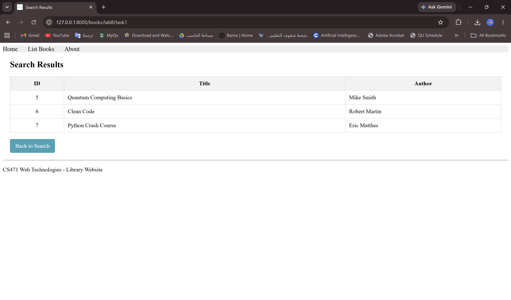
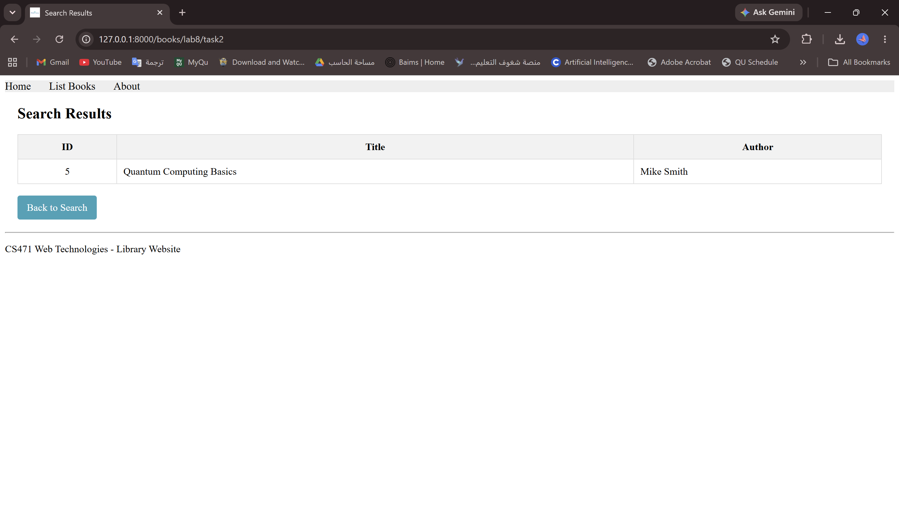
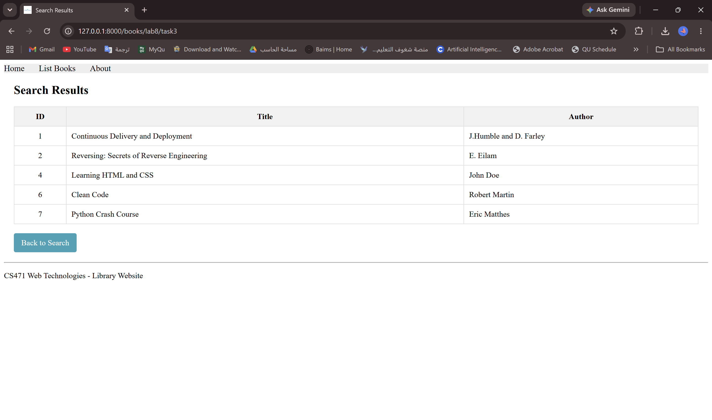
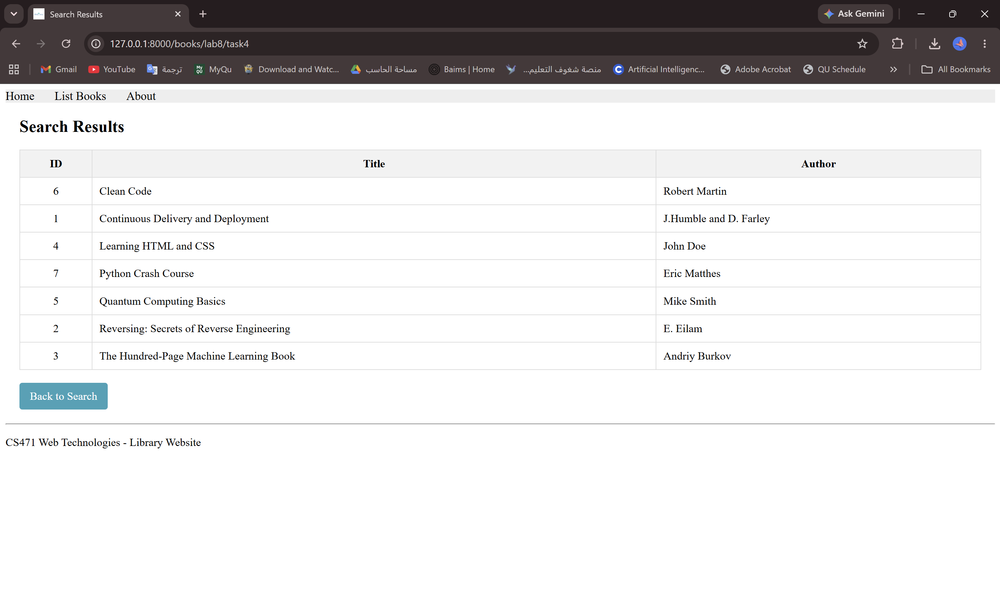
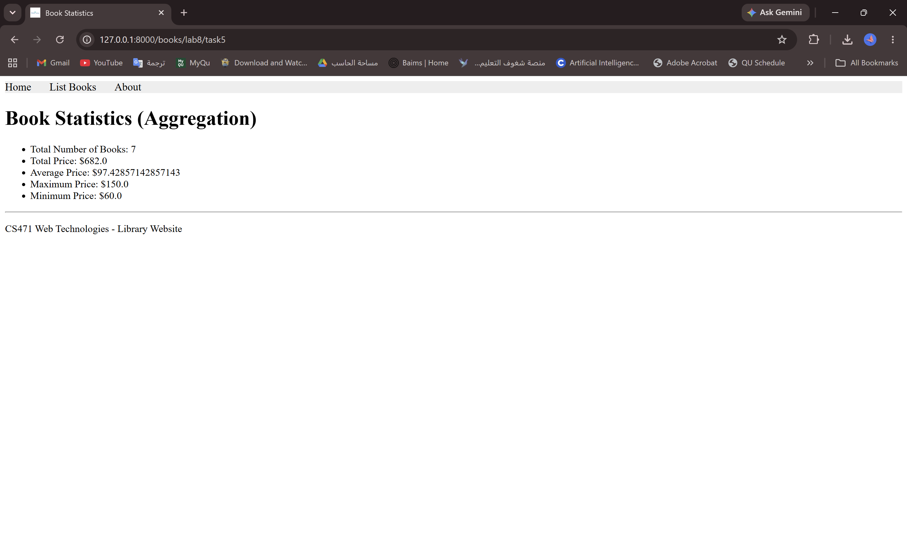
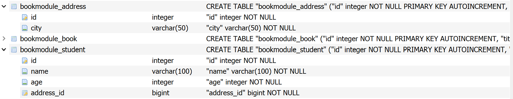
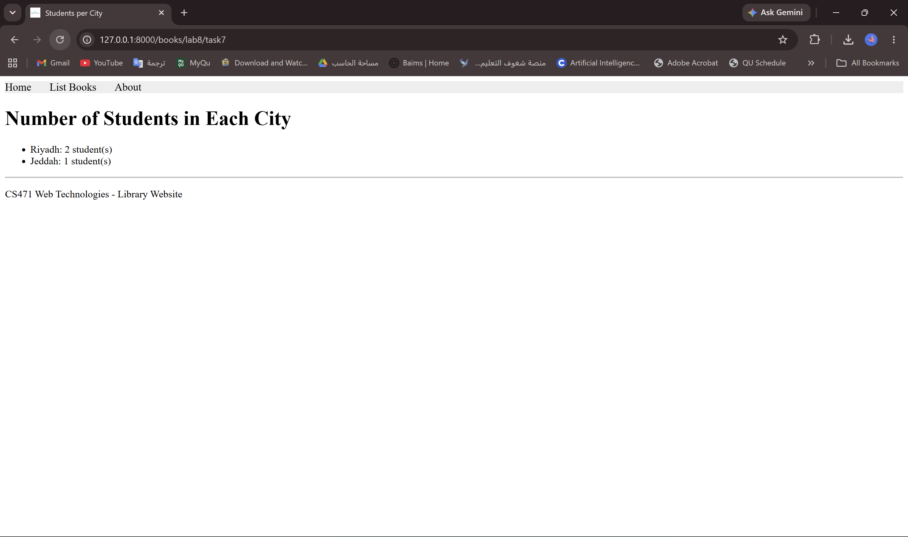

# Lab 8 – Screenshots

## Task 1 – Q operator – `/books/lab8/task1`

Books with price <= 80.

## Task 2 – Combining Q (& and |) – `/books/lab8/task2`

Books with edition > 3 and title or author containing "qu".

## Task 3 – NOT operator (~) – `/books/lab8/task3`

Books with edition <= 3 and title or author not containing "qu".

## Task 4 – order_by – `/books/lab8/task4`

All books ordered by title.

## Task 5 – Aggregation – `/books/lab8/task5`

Number of books, total, average, maximum and minimum price.

## Task 6 – Student and Address models

New tables `bookmodule_address` and `bookmodule_student` in the database.

## Task 7 – Students per city – `/books/lab8/task7`

