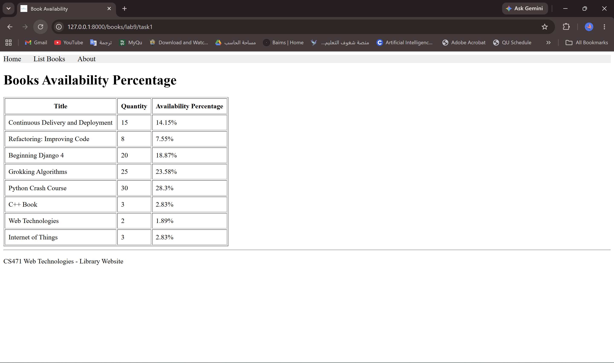
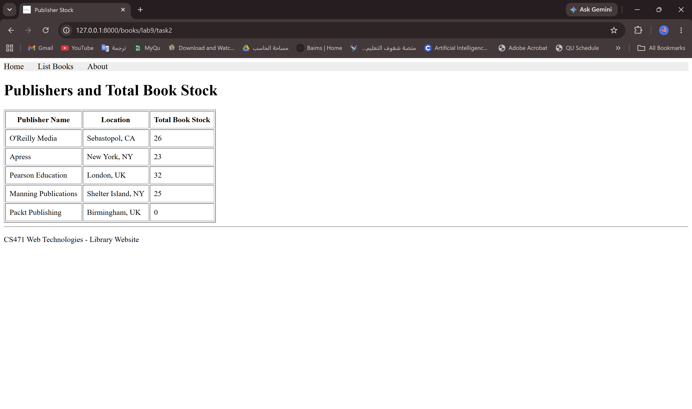
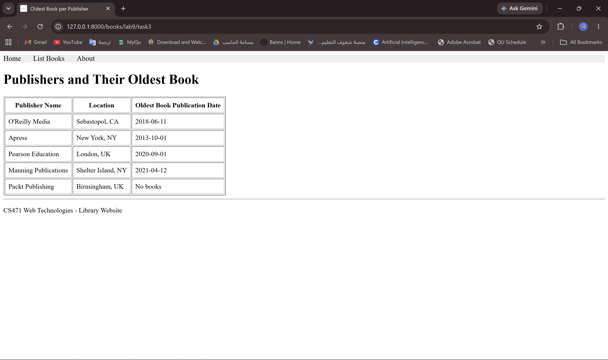
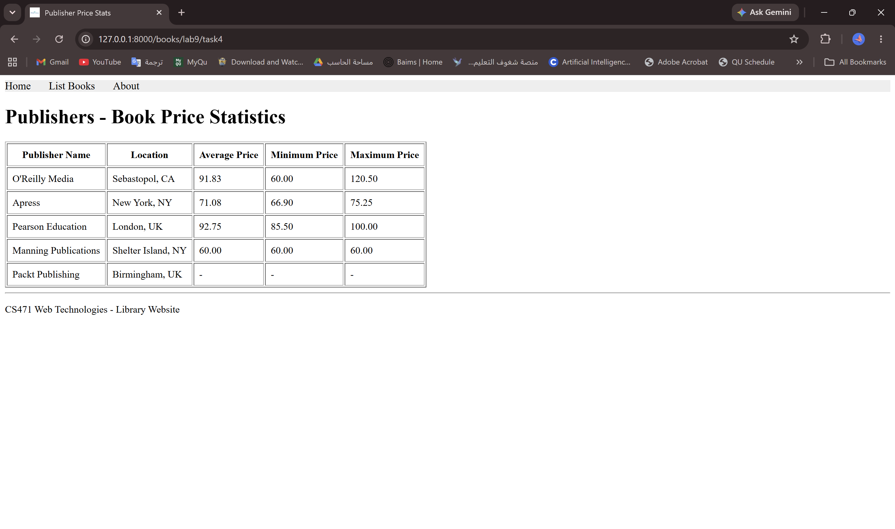
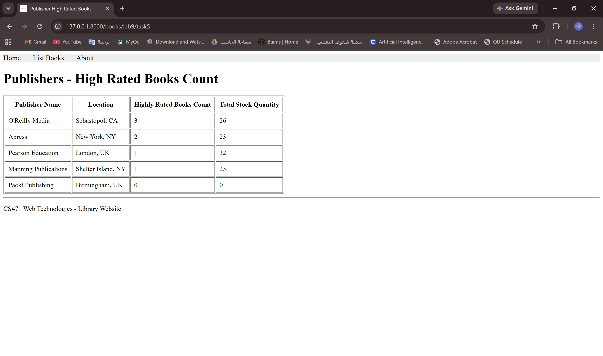
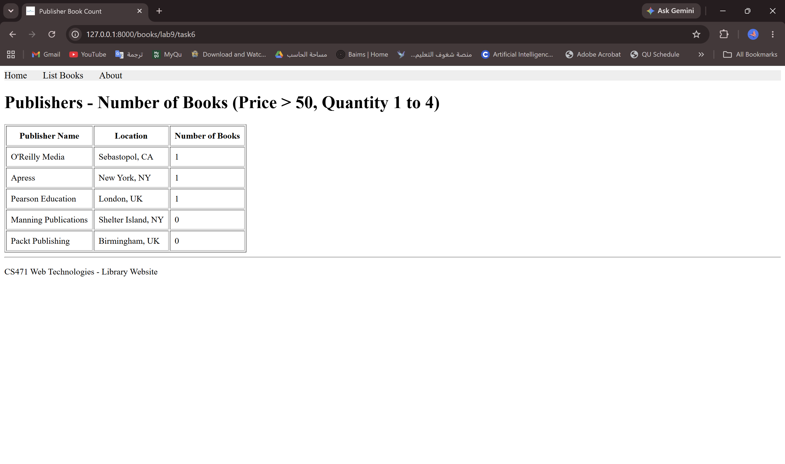

# Lab 9 – Screenshots

## Task 1 – Availability percentage – `/books/lab9/task1`

Books with their availability percentage (transient property).

## Task 2 – Total stock per publisher – `/books/lab9/task2`

## Task 3 – Oldest book per publisher – `/books/lab9/task3`

## Task 4 – Average, min and max price per publisher – `/books/lab9/task4`

## Task 5 – Highly rated books per publisher – `/books/lab9/task5`

Publishers with the count of books rated 4 or higher and their total quantity.

## Task 6 – Book count per publisher (filtered) – `/books/lab9/task6`

Books with price > 50 and quantity from 1 to 4.

